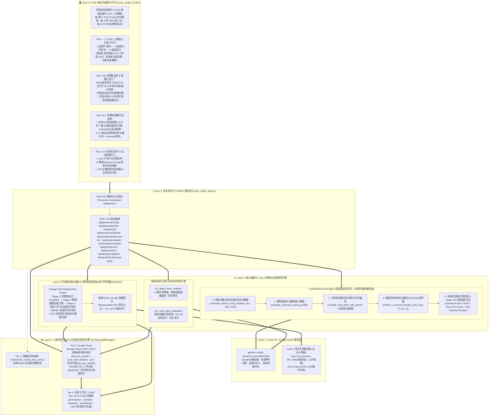
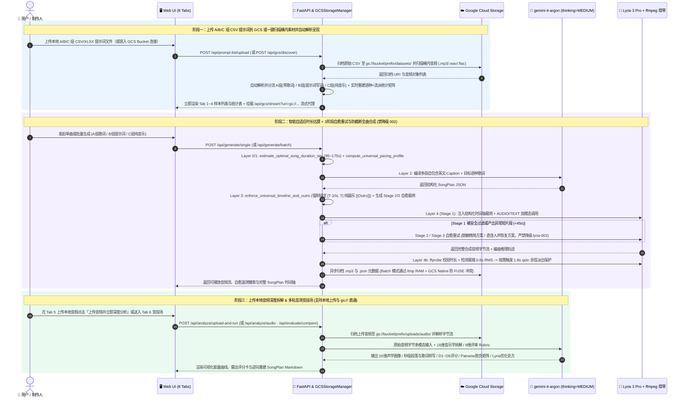

# 🎼 MuseWave Studio · 全景音乐创作与声学洞察 (Music Creation & Acoustic Intelligence)

通用、高灵活度、全可配置的 **智能结构化音乐创作（Single & Batch）· 全音频深度声学洞察 · 多轨盲测/明测竞技场** 一体化工作台。
底层推理、SongPlan 编译、音乐拆解与多轨评审均默认驱动 **`gemini-4-argon` (`thinking_level="MEDIUM"`)**，音乐合成引擎深度融合 **Vertex AI Lyria 3 (`lyria-3-pro-preview` / `lyria-3-clip-preview`)** 结构化编曲、**3 阶段自愈重试引擎 (3-Stage Self-Healing Retry)**、**智能词量/流派自适应时长控制 (`95s–175s`)** 与 **Cloud Run 全链路结构化 Trace 日志 (`log_runtime` + `/api/logs`)**。

---

## 1. 目录结构

```text
./music-studio/
├── music_studio_app.py                         # FastAPI 核心后端（SHA-256 Gatekeeper + GCSStorageManager + LyriaBestPracticeEngine + CostAnalyticsEngine 全链路成本核算）
├── music_studio_ui.html                        # 9-Tab 响应式全功能 Web UI 工作台（含 💰 全链路成本看板 & CSV 导出 + A/B/C 组 CSV 上传至 GCS 自动解析呈现 & 上传音频深度分析）
├── deploy_cloud_run.sh                         # Cloud Run 一键部署脚本（零明文 SHA-256 Passcode 模式 + GCS FUSE 挂载）
├── Dockerfile                                  # Cloud Run 容器镜像构建定义（Python 3.11 + ffmpeg 响度与尾端淡出处理）
├── requirements.txt                            # Python 依赖声明
├── README.md                                   # 架构说明、GCS 自动装载指南、Lyria 3 提效机制与部署手册
├── README_DURATION_AND_CLOUDRUN_DEEPDIVE.md    # [Supplement 1] 通用时长精准控制与防截断架构 + Cloud Run GCS FUSE 容灾 Deep-Dive & Checklist
├── README_STABILITY_AND_DURATION_ANALYSIS.md   # [Supplement 2] 音乐生成稳定性、人声保持与时长分布深度剖析及自愈优化指南 (30s纯音乐退化根因 & 175-179s聚集根因)
└── data/                                       # 评测集 Schema 目录（零预置业务数据，连接 GCS Bucket 或上传 A/B/C 组 CSV 后自动解析呈现）
    └── text2music_120_dataset.json             # 空置标准 Schema 模板（version: 2.0-gcs-autoload, items: []）
```

> 📌 **专项技术补充文档导航**：
> - **[`README_STABILITY_AND_DURATION_ANALYSIS.md`](./README_STABILITY_AND_DURATION_ANALYSIS.md)**：深度剖析 **为什么批量生成会出现少量 ~30 秒纯音乐退化**、**为什么生成时长不超 3 分钟且集中在 175–179 秒**，以及 v2.1 **取消 `lyria-002` 降级路由 + Lyria 3 三阶段自愈重试 + 智能自适应时长 (`95s–175s`)** 完整架构方案。
> - **[`README_DURATION_AND_CLOUDRUN_DEEPDIVE.md`](./README_DURATION_AND_CLOUDRUN_DEEPDIVE.md)**：四层通用时长对齐、独立纯器乐 `[[Outro]]` 收束锚点与 Cloud Run GCS FUSE 高并发三级存储隔离深度解析。

---

## 1.5 系统全景架构图 (Mermaid Architecture Diagrams)

### (A) 五层全栈系统架构图 (`flowchart TB`)



### (B) 核心工作流：A/B/C 组 CSV 上传至 GCS 自动解析 + 防截断全曲生成 + 上传音频深度听审时序图 (`sequenceDiagram`)



---

## 2. GCS 自动装载、A/B/C 组 CSV 上传解析与 8 大功能工作台映射

应用默认不包含任何硬编码客户评测数据（`data/text2music_120_dataset.json` 初始为空置模板）。用户可通过以下两种方式装载与管理数据：
1. **上传 A/B/C 组 CSV 提示词到 GCS 并自动解析呈现 (`POST /api/prompt-list/upload`)**：在顶部横幅、A/B/C 各组侧边栏或 Tab 4 选择单份或多份 CSV/XLSX/JSON/TXT 文件，系统会自动将原始文件上传归档至 GCS Bucket（`datasets/<filename>`），同时自动识别并分流 A/B/C 组（或按指定组别归类），根据 `请求时长参数_秒(duration)` 与歌词密度智能计算 `target_duration_sec`（`95s–175s`），实时生成语种×流派分布统计表，并立即渲染到 Tab 1（A组）、Tab 2（B组）、Tab 3（C组）和 Tab 4 全景表中。
2. **填入 GCS Bucket 一键扫描自动装载 (`POST /api/gcs/discover`)**：在顶部横幅填入 GCS Bucket 名称，系统自动扫描桶内已有的题单文件（`.csv`, `.xlsx`, `.tsv`, `.json`, `.txt`）与音频素材（`.mp3`, `.wav`, `.flac`, `.m4a`, `.ogg`），并根据曲目特征智能分流至各大工作台：

| 输入模式 / 功能模块 | 自动分流规则与核心特征 | 映射的功能 Tab | 核心能力 |
| :--- | :--- | :--- | :--- |
| **A组 · 用户歌词成曲**<br>(`group="A"`, `is_instrumental=0`) | 包含用户提供的完整结构化歌词（如 `[Verse]` / `[Chorus]`）、风格描述、流派与人声性别标签。 | **Tab 1: 🎤 A组 · 用户歌词成曲** *(独立 DOM 工作台 `_A`)* | 支持侧边栏直接上传 A 组 CSV 到 GCS 并自动渲染；锁定用户原词 (`is_user_provided=true`)，使用 `gemini-4-argon (thinking=MEDIUM)` 生成分段自包含英文配器/混音/人声描述，调用 Lyria 3 生成全曲（带 3 阶段自愈重试）；支持多样本/跨组非阻塞并发生成与多版本历史切换 (`v1/v2/v3...`)。 |
| **B组 · 提示词写词成曲**<br>(`group="B"`, `is_instrumental=0`) | 用户仅提供简短风格、情绪或场景提示词（无手填歌词），指定目标演唱语种与人声特征。 | **Tab 2: ✨ B组 · 提示词写词成曲** *(独立 DOM 工作台 `_B`)* | 支持侧边栏直接上传 B 组 CSV 到 GCS 并自动渲染；由 `gemini-4-argon (thinking=MEDIUM)` 根据简短提示词自动创作目标语种押韵歌词 + 多段式英文声学描述，再交由 Lyria 3 谱曲演唱；与 A/C 组完全独立状态、互不阻塞。 |
| **C组 · 纯音乐与配乐**<br>(`group="C"`, `is_instrumental=1`) | 纯音乐/器乐配乐模式 (`is_instrumental=1`)，支持任意语种场景提示词与自定义曲长。 | **Tab 3: 🎹 C组 · 纯音乐与配乐** *(独立 DOM 工作台 `_C`)* | 支持侧边栏直接上传 C 组 CSV 到 GCS 并自动渲染；强制锁定 `is_instrumental=1`（清空歌词并在每段注入 `purely instrumental, no vocals, no singing`），将多语种场景提示词编译为纯器乐动态起伏编曲。 |
| **评测集全景与批量工厂** | 自动汇总上传 CSV 或 GCS 装载题单的语种×流派交叉分布矩阵、时长分位数与 Lyria 语种支持度统计。 | **Tab 4: 📊 评测集全景 & 批量生成工厂** | 支持 **批量上传多份 A/B/C 组 CSV/XLSX 到 GCS 并实时解析渲染**、**切换智能自适应时长 (`smart_auto`) 与参考时长对齐 (`match_reference`)**、**一键按曲目 ID 自动关联 GCS 参考音源** 与 **多线程批量生成音乐**。 |
| **多模态音频深度理解** | 基于 `gemini-4-argon (thinking_level="MEDIUM")` 的多模态音频分析引擎。 | **Tab 5: 🔬 音乐深度分析** | 支持 **上传本地音频文件 (`.mp3/.wav/.flac/.m4a/.ogg`) 自动归档至 GCS 并一键启动深度分析 (`POST /api/analyze/upload-and-run`)**，也支持直接选择/输入 **`gs://` 云端音频 URI**，输出 16 维全局声学画像、秒级曲式段落拆解、1–10 动态能量曲线、带时间戳歌词转写、混音诊断，并逆向重建 **Lyria SongPlan Markdown**。 |
| **多音轨盲测/明测评审** | 基于 `gemini-4-argon (thinking_level="MEDIUM")` 的多音轨同窗对比评审团。 | **Tab 6: ⚖️ 多首音乐评判竞技场** | 支持 2–6 首音乐（含本地上传音频或 **GCS 动态发现音频 `gs://...`**）在同一上下文窗口内同场竞技，输出 6 维量化评分（D1–D6）、两两对决胜负矩阵（Pairwise Matrix）与下一轮 Lyria 优化处方。 |
| **全链路成本核算与 CSV 导出** | 覆盖 `gemini-4-argon` 编曲增强、Lyria 3 合成与 `gemini-4-argon` 多模态深度听审的全链路精算引擎 (`CostAnalyticsEngine`)。 | **Tab 7B: 💰 全链路成本看板** | 按 **A组（歌词定制成曲）/ B组（灵感写词谱曲）/ C组（纯音乐与配乐）** 分组对比并逐首计算全链路成本（USD & CNY 双币种、每秒音频单价、各阶段 Token 与费用占比），支持实时自定义单价参数并 **一键导出全量或按组（A/B/C/ALL）CSV 财务明细表**。 |
| **架构白皮书 & 全局配置中心** | 音乐生成最佳实践架构说明 + 模型/Prompt/GCS 素材发现中心。 | **Tab 7 & Tab 8: 🧠 底层原理 / ⚙️ 全局配置 & GCS** | 在线热更新 `gemini-4-argon`、Lyria 3 模型、自愈重试与时长策略、三大 System Prompts 以及可配置 GCS Bucket，支持 **全桶动态扫描发现音频与数据集素材、在线流式试听、一键装载 GCS 题单及一键送入分析/竞技场**。 |

---

## 3. Lyria 3 结构化编曲与八大工程提效机制 (`LyriaBestPracticeEngine`)

我们在 `LyriaBestPracticeEngine` 中实现了 **8 大核心工程提效机制**：

1. **支柱一：段落级自包含英文编曲描述 (Self-Contained Section Captions)**
   - **核心原理**：在多段式音乐生成中，每个曲式段落（`[Intro]`, `[Verse 1]`, `[Chorus]`, `[Bridge]`, `[Outro]`）的声学描述相互独立。生成后续段落时若仅使用相对描述（如 `"Chorus is louder than Verse 1"`），容易导致主唱音色漂移、速度突变或核心配器丢失。
   - **工程实现**：由 `gemini-4-argon (thinking_level="MEDIUM")` 为每个段落编写 **40–60 词完全自包含的英文声学段落（Self-Contained English Acoustic Caption）**，每段都显式重申核心流派、BPM 律动、当前激活乐器、混音空间感以及主唱性别/音色。

2. **支柱二：声学描述全英文化 vs. 演唱歌词目标语种锁定**
   - **核心原理**：音乐生成模型的声学与配器条件对专业英文制作术语具有最高的控制精度，而人声咬字合成器则直接遵循歌词文本本身的目标语种。
   - **工程实现**：自动将非英文的人声性别与风格描述精准转译为专业英文音乐制作术语（如 `"Male baritone lead vocalist"`, `"Female soprano lead vocalist"`）；同时严格保持 `lyrics` 为用户指定的目标演唱语种。

3. **支柱三：规范化曲式时间轴标签与分段歌词对齐 (`sections[]` + `lyrics[]`)**
   - **工程实现**：`LyriaBestPracticeEngine.transpile_plan_to_lyria_formats` 自动将编曲计划组装为带精确起止秒数的规范化多段序列（`[Intro 0s-12s]`, `[Verse 1 12s-42s]`, ...）、时间对齐歌词列表与结构化 `SongPlan` Markdown 格式，并从歌词流中剔除纯器乐占位伪行，确保人声合成信噪比最大化。

4. **支柱四：模型感知的时长边界控制 (`30.0s` 单段 vs. `60.0s–180.0s` 多段) 与智能词量/流派自适应时长估算 (`estimate_optimal_song_duration_sec`)**
   - **工程实现**：自动识别 `lyria-3-clip-preview`（`30.0s` 单段模式）与 `lyria-3-pro-preview`（`60.0s–180.0s` 多段全曲模式）。当题单 `duration=auto` 时，系统不再盲目拷贝外部对照音频实测时长并全部截断至 `180.0s`，而是根据 A 组真实歌词行数/字符密度或 B/C 组流派速度感智能估算 **`95s–175s`** 的最适成曲时长。

5. **支柱五：原创性保护与艺人名预检脱敏**
   - **工程实现**：编译器在预处理阶段自动将提示词中出现的真实艺人或乐队名称转化为纯声学、年代、流派与音色特征描述，避免触发版权安全过滤拦截。

6. **支柱六（专项补充文档 1）：通用时长精准控制与防截断四层架构 + Cloud Run GCS FUSE 高并发隔离**
   - **完整技术白皮书与核查清单（Checklist）请参阅**：[`README_DURATION_AND_CLOUDRUN_DEEPDIVE.md`](./README_DURATION_AND_CLOUDRUN_DEEPDIVE.md)
   - **核心亮点**：
     - **三态通用配速与密度计算器 (`compute_universal_pacing_profile`)**：统一适配纯音乐 (`instrumental`)、无词人声 (`vocal_auto_lyrics`)、带词人声 (`vocal_user_lyrics`: Sparse `<0.65` / Balanced / Dense `>0.92`)。
     - **确定性时间轴与独立纯器乐 `[[Outro]]` 锁死器 (`enforce_universal_timeline_and_outro`)**：自动拆分合并的 `"Final Chorus & Outro"`，在 `[T - 10s, T]` 锚定零歌词纯器乐收尾段并归一化段内 `[start:end]` 歌词时间码。
     - **结构化时长指令透传 + 尾端 RMS (`-26 dB`) 智能 `qsin` 余弦淡出保护**：防止提示词重写阶段缩短时长，消除末尾硬切感。
     - **Cloud Run `/tmp` RAM + GCS Native SDK + FUSE 终态单次写盘三级隔离**：彻底根除 `SetInodeAttributes: stale file handle` 并发写冲突与跨实例轮询 404。

7. **支柱七：Google Cloud Storage (GCS) 动态素材发现、在线流式代理与自动数据集装载 (`GCSStorageManager.discover_assets`)**
   - **全桶动态发现与自动装载 (`GET/POST /api/gcs/discover`)**：自动扫描配置的 GCS Bucket 与前缀，直接发现桶内所有原生音频与题单文件，自动解析并分流填充至 A/B/C 三组工作台，同时按曲目编号自动关联桶内参考音频。
   - **任意 `gs://` 音频在线流式代理与多模态直通 (`GET /api/gcs/stream?uri=gs://...`)**：支持将任意 `gs://<bucket>/<object>` 实时代理为浏览器可播放音频流，并原生直通 Tab 5 深度分析与 Tab 6 多轨竞技场。

8. **支柱八（专项补充文档 2）：取消 `lyria-002` 降级路由 + Lyria 3 三阶段自愈重试引擎 + 生成时长分布深度剖析**
   - **完整根因分析与架构优化白皮书请参阅**：[`README_STABILITY_AND_DURATION_ANALYSIS.md`](./README_STABILITY_AND_DURATION_ANALYSIS.md)
   - **核心亮点**：
     - **彻底移除 `lyria-002` 降级路由**：杜绝因单次瞬时限流或安全拦截而静默回退至 30 秒纯音乐基线模型的现象。
     - **3 阶段自愈重试引擎 (3-Stage Self-Healing Retry)**：在 `lyria-3-pro-preview` 上依次执行 `Stage 1 (完整多段式 SongPlan)` → `Stage 2 (紧凑脱敏自愈方案)` → `Stage 3 (直连人声与全曲时长恢复方案)`，并配合合成后 `ffprobe` 时长探针（全曲请求若产出 `< 45.0s` 异常片段立即判定为退化并触发下一阶段自愈）。
     - **智能自适应时长估算 (`95s–175s`)**：消除因拷贝外部 >180s 参考时长并统一截断至 `180.0s` + 尾端静音裁剪所导致的 `175–179s` 挤压效应。

9. **支柱九：全链路单曲与分组成本精算引擎 (`CostAnalyticsEngine` + `💰 全链路成本看板` + CSV 导出)**
   - **三阶段全链路逐曲精算公式**：
     - **阶段 1（`gemini-4-argon` 智能编曲与提示词增强）**：实时采集 API 返回的 `usage_metadata`（`prompt_token_count` / `candidates_token_count` / `thoughts_token_count`），或根据各组歌词与提示词载荷精准核算 Input / Output / Thinking Tokens 成本。
     - **阶段 2（Lyria 3 音乐合成）**：支持 **按首计费 (`per_track`，默认 `lyria-3-pro-preview` `$0.080/首`、`lyria-3-clip-preview` `$0.040/首`)** 与 **按秒计费 (`per_second`)** 两种计费模式，并支持统计并发候选轨 (`parallel_tracks`) 与自愈重试次数。
     - **阶段 3（`gemini-4-argon` 16维多模态深度音乐分析）**：基于 `32 tokens/秒` 音频多模态编码与结构化 JSON 输出/思考 Tokens 核算每首歌的深度听审成本。
   - **按组（A / B / C / U）独立汇总与一键 CSV 导出 (`GET /api/cost/export.csv`)**：支持在 **「A/B/C 全题单全链路成本全景」** 与 **「已生成实测曲目账单」** 两个口径间自由切换，提供 `ALL`、`A组`、`B组`、`C组` 一键导出 UTF-8 with BOM (`.csv`) 财务明细表（可直接用 Excel 打开）。

---

## 4. Cloud Run 一键部署指南（支持零明文 SHA-256 Passcode 模式）

进入项目目录：
```bash
cd ./music-studio
```

### 方式 A（推荐）：交互式零明文 SHA-256 Passcode 模式
终端会隐藏输入您的访问口令，在本地计算 64 位 SHA-256 哈希摘要后仅将哈希值注入 Cloud Run 环境变量（口令明文永不落盘、永不进入命令历史）：
```bash
PROMPT_PASSCODE="true" \
GOOGLE_CLOUD_PROJECT="your-gcp-project-id" \
GCS_BUCKET_NAME="your-gcs-bucket-name" \
./deploy_cloud_run.sh
```

若 IAM 权限与 API 此前已配置完成，二次更新部署时可传入 `SKIP_IAM_SETUP="true"`（或命令行参数 `--skip-iam-setup`）直接跳过 API 启用与 IAM 策略绑定：
```bash
PROMPT_PASSCODE="true" \
SKIP_IAM_SETUP="true" \
GOOGLE_CLOUD_PROJECT="your-gcp-project-id" \
GCS_BUCKET_NAME="your-gcs-bucket-name" \
./deploy_cloud_run.sh
```

或者直接传入预计算好的 64 位 SHA-256 哈希值：
```bash
MUSIC_STUDIO_PASSCODE_SHA256="$(printf '%s' 'YourSecretPasscode' | sha256sum | awk '{print $1}')" \
SKIP_IAM_SETUP="true" \
GOOGLE_CLOUD_PROJECT="your-gcp-project-id" \
GCS_BUCKET_NAME="your-gcs-bucket-name" \
./deploy_cloud_run.sh
```

### 方式 B：默认 IAM 零信任模式 (`--no-allow-unauthenticated`)
```bash
GOOGLE_CLOUD_PROJECT="your-gcp-project-id" \
GCS_BUCKET_NAME="your-gcs-bucket-name" \
./deploy_cloud_run.sh
# 部署完成后通过本地安全代理访问：
gcloud run services proxy music-studio --region us-central1 --port 8080
```
