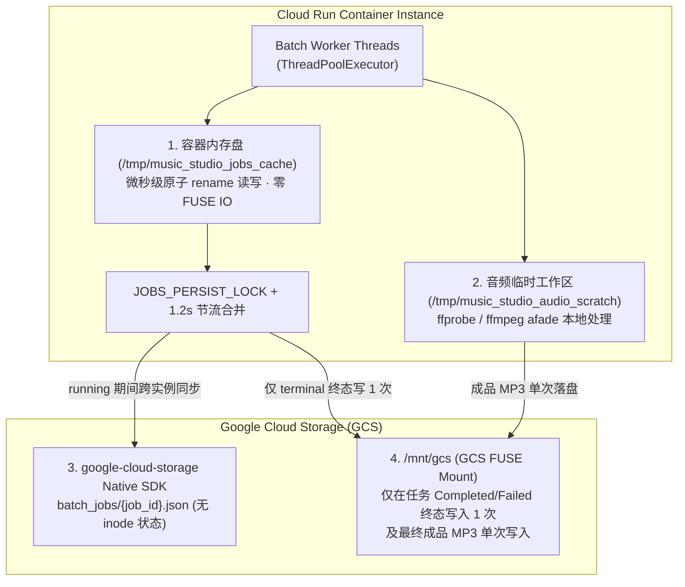

# 🔬 Lyria 通用时长精准控制与防截断架构 + Cloud Run 高并发容灾 Deep-Dive & Checklist

> **文档定位**：本文档作为 `MuseWave Studio · 全景音乐创作与声学洞察` 的核心架构深度解析补充手册（README Supplement 1），从多段式生成音乐模型的条件化架构与信号处理机制出发，完整剖析为什么 AI 音乐生成会出现**「时长不符」**与**「末尾人声/旋律生硬截断」**，并给出覆盖**全部三类通用输入形态（纯音乐 / 无词人声 / 带词人声）**的工程化解决方案与 Cloud Run 生产级核查清单（Checklist）。
>
> 🔗 **姊妹篇补充文档**：关于批量生成中出现的 **「少量 ~30 秒纯音乐退化根因」**、**「生成时长上限与 175–179 秒聚集根因」** 以及 **「取消经典基线降级 + Lyria 3 三阶段自愈重试 + 智能词量/流派自适应时长 (`95s–175s`)」** 的专项剖析，请同步参阅 **[`README_STABILITY_AND_DURATION_ANALYSIS.md`](./README_STABILITY_AND_DURATION_ANALYSIS.md)**。

---

## 目录

1. [第一部分：为什么生成的音频没有按要求时长生成且会被截断？（底层机制剖析）](#1-第一部分为什么生成的音频没有按要求时长生成且会被截断底层机制剖析)
2. [第二部分：通用时长精准控制与防截断架构设计（覆盖 3 大通用输入形态）](#2-第二部分通用时长精准控制与防截断架构设计覆盖-3-大通用输入形态)
3. [第三部分：Cloud Run 多实例与 GCS FUSE 高并发架构排障 Deep-Dive](#3-第三部分cloud-run-多实例与-gcs-fuse-高并发架构排障-deep-dive)
4. [第四部分：全链路优化核查清单（Master Review & Production Checklist）](#4-第四部分全链路优化核查清单master-review--production-checklist)

---

## 1. 第一部分：为什么生成的音频没有按要求时长生成且会被截断？（底层机制剖析）

在生产环境中调用生成式音乐模型（`lyria-3-pro-preview` / `lyria-3-clip-preview`）时，导致**生成时长偏离请求值**以及**歌曲末尾被生硬腰斩（Truncation）**主要由以下 **5 个核心机制根因**引起：

### 根因 1：模型家族的「离散时长物理窗口」与采样帧边界裁剪
不同 Lyria 3 模型并非支持任意连续秒数，而是具有明确的物理有效窗口与尾部静音剥离机制：

| 模型 ID | 架构模式 | 物理有效时长窗口 | 边界裁剪与尾部静音剥离行为 |
| :--- | :--- | :--- | :--- |
| **`lyria-3-pro-preview`** | 多段全曲编排模式 (Multi-Section Full Song) | **`60.0s – 180.0s`** | 支持在 `[60.0, 180.0]` 秒区间内按时间轴多段生成。生成完成后，后端按目标帧窗口对音频采样执行边界切片，并自动剥离尾部的纯静音帧。 |
| **`lyria-3-clip-preview`** | 单段精华切片模式 (Single-Section Clip) | **固定 `30.0s`** | 强制走单段 30 秒生成窗口，任何超过 30 秒的编曲与歌词在 `30.0s` 边界处被直接截断。 |
| *(已移除回退路由)* | 早期 30s 纯器乐基线模型 | **固定 `~30s–32.8s`** | 不支持自定义时长参数与人声歌词；本工作台 v2.1 已彻底移除向该模型的降级路由，改用 `lyria-3-pro-preview` 三阶段自愈重试。 |

**直接后果**：
1. 当目标时长 `< 60s`（如 `42s`）却调用 `lyria-3-pro-preview` 时，服务端会将目标时长拉回 `[60, 180]` 有效区间；反之若目标时长 `> 180s`（如 `240s`），音频会在 `180.0s` 上限边界处触发硬切断。
2. 如果模型在目标 `duration_secs` 之前过早完成终止和弦，尾部的静音剥离逻辑会自动把末尾静音帧裁掉，导致返回的音频实测秒数比请求值短 3–10 秒。

---

### 根因 2：段落结构仅由起始时间点 `start` 驱动，且缺少独立纯器乐 `[Outro]` 缓冲区
在多段式音乐生成规范中，曲式段落数组 `sections` 的每个段落通过起始时间戳 `start`（秒）和声学描述 `text` 定义：

```json
{
  "duration_secs": 150.0,
  "bpm": 120.0,
  "sections": [
    {
      "section_code": "[Intro]",
      "caption": { "start": 0.0, "text": "Self-contained English intro description..." }
    },
    {
      "section_code": "[Verse 1]",
      "caption": { "start": 18.0, "text": "Self-contained English verse description..." }
    }
  ]
}
```

多段编曲结构示例如下：

```text
Tempo: 120 BPM | Target Duration: 150.0s
[Intro] (0.0s-18.0s): <Intro caption>
[Verse 1] (18.0s-48.0s): <Verse 1 caption>
...
[Outro] (138.0s-150.0s): <Outro caption>
```

**为什么这会导致严重的「末尾截断感」？**
- 每个段落的结束时间完全由**下一个段落的 `start`** 或**全曲总上限 `duration_secs`** 隐式决定。
- 当规划模型将最后一段写成 `"Final Chorus & Outro"`（高潮副歌与尾奏合并），或者把最后一句歌词排到 `duration_secs - 2s` 时，生成模型在最后一段收到的指令仍然是高能量的副歌配器与主唱发声。
- 当扩散采样到达 `duration_secs` 终点帧时，**模型正处于主唱拖长音或副歌满配器高潮中，没有任何收尾和弦（Resolving Cadence）或渐弱指令，直接在终点帧处停止**，听感上就像磁带被突然拔掉。

---

### 根因 3：三种通用输入形态下的「歌词/声学密度失配」(Density Mismatch)
在实际业务中，用户输入分为三种通用形态：
1. **形态 A（纯音乐 `is_instrumental=true`）**：无歌词，完全靠段落切换驱动时间轴。若段落过少（如 150s 只有 3 段），单段长达 50s，扩散模型在长段落后半程极易提前进入终止式，随后被尾部静音裁剪切短。
2. **形态 B（有人声但无预设歌词 `vocal_auto_lyrics`）**：由 LLM 自动写词。若未根据目标时长约束总行数，LLM 往往生成固定 24–32 行歌词，在 60s 短曲中唱不完被腰斩，在 180s 长曲中又过早唱完。
3. **形态 C（有人声且用户锁定原词 `vocal_user_lyrics`）**：用户歌词不可删改 (`is_user_provided=true`)。当用户提供 45 行密集歌词却要求在 75s 内唱完时，平均每行仅 `1.6s`；而人声自然咬字速率受 BPM 强约束，结果必然是在第 75.0s 时才唱到第 32 行，剩余 13 行被硬生生截断。

---

### 根因 4：提示词规范化重写阶段的「时长覆盖」
当向多段全曲模型发送非结构化的自然语言 Prompt 时，若未显式声明目标 `duration_secs`、段落 `[start:]` 时间轴锚点以及 `"Do NOT shorten duration_secs; preserve the final pure-instrumental [OUTRO] section"` 强约束，上游提示词解析器可能会根据估算的歌词行数重新推算一个较短的 `duration_secs`（例如把用户要求的 150s 改写为 105s）。

---

### 根因 5：冗余的二次 `ffmpeg loudnorm` 与边界残余能量
- Lyria 3 全曲模型输出默认已针对 `-14.0 dB` 响度与 `192kbps` 码率进行了母带校准。无条件对所有生成音频再跑一次 `ffmpeg loudnorm=I=-14` 不仅增加 1.5–3s 延迟，而且其内部的动态包络前瞻窗口会对尾端音量做二次增益拉升。
- 真正需要的后处理是：**检测音频最后 `0.6s` 的真实均方根能量（Tail RMS dB）**——仅当尾端未自然衰减至静音（如 `Tail RMS > -26.0 dB`）时，才在最后 `1.8s` 施加对数余弦淡出曲线 (`afade=t=out:curve=qsin`)。

---

## 2. 第二部分：通用时长精准控制与防截断架构设计（覆盖 3 大通用输入形态）

为彻底解决上述 5 大根因，同时保证架构**100% 通用（不绑定任何特定评测集或固定曲长）**，我们在 `LyriaBestPracticeEngine` (`music_studio_app.py`) 中实现了 **四层闭环防截断工程架构**：


### 2.1 第一层：通用三态配速与密度适配器 (`compute_universal_pacing_profile`)
在调用 `gemini-4-argon` 编译 `SongPlan` 之前，`compute_universal_pacing_profile(duration_secs, is_instrumental, has_user_lyrics, raw_lyrics_text, model_id, outro_buffer_sec)` 会根据**目标时长**、**所选模型**和**输入形态**自动计算物理可行的窗口参数：

| 输入状态 (`input_mode`) | 判定条件 | 自适应时间轴与防截断调度策略 |
| :--- | :--- | :--- |
| **State 1: 纯器乐模式**<br>(`instrumental`) | `is_instrumental == True` | • 强制锁定 `lyrics = []`，每段声学描述注入 `"purely instrumental, no vocals, no singing"`。<br>• 按 `max(4, min(8, round(effective_sec / 22.0)))` 自动规划结构化段落数（每 18–25s 一次声学织体演进：如 `[[Intro]] -> [[Theme A]] -> [[Rhythmic Build]] -> [[Climax]] -> [[Bridge]] -> [[Outro]]`），防止单段过长导致模型提前收束。<br>• 严格预留末尾 `outro_sec`（默认 `12.0s`）给独立 `[[Outro]]`。 |
| **State 2: 无预设歌词人声**<br>(`vocal_auto_lyrics`) | `is_instrumental == False` 且用户未提供歌词 | • 计算黄金演唱窗口 `singable_window_sec = effective_sec - intro_sec - outro_sec`。<br>• 按 `0.26–0.42 行/秒`（约每行 `2.4s–3.8s`）反推目标创作歌词行数区间 `[target_min_lines, target_max_lines]`，注入 `gemini-4-argon` 编译指令，从源头杜绝「写词过多唱不完」或「写词太少早早结束」。 |
| **State 3: 用户带歌词人声**<br>(`vocal_user_lyrics`) | `is_instrumental == False` 且用户提供了原词 | • 100% 锁定用户原词 (`is_user_provided=true`)，统计真实非空行数 $N_{\text{lines}}$ 与字符密度 $\rho = N_{\text{lines}} / T_{\text{singable}}$：<br>  - **稀疏歌词 ($\rho < 0.65\text{ lines/s}$)**：自动在主歌/副歌之间插入纯器乐间奏段 (`[[Instrumental Interlude]]` / `[[Guitar/Synth Solo]]`, `lyrics: []`) 撑满时间轴。<br>  - **均衡歌词 ($0.65 \le \rho \le 0.92\text{ lines/s}$)**：标准前奏 (`4–8s`) + 标准段间呼吸。<br>  - **密集歌词 ($\rho > 0.92\text{ lines/s}$ 或 $> 4.5\text{ chars/s}$)**：自动将前奏压缩至极短 Cold-Open (`1.5s–2.5s`)，消除段间空隙，并在声学描述中附加 `"upbeat rhythmic phrasing, crisp tight syllabic articulation"` 提示。 |

---

### 2.2 第二层：确定性时间轴归一与独立纯器乐 `[[Outro]]` 锁死器 (`enforce_universal_timeline_and_outro`)
由于 LLM 生成的 JSON 时间戳可能存在浮点漂移或习惯性合并尾段，我们在 Python 侧编写了**确定性后处理器 `enforce_universal_timeline_and_outro(plan, target_duration_sec, is_instrumental, outro_buffer_sec)`**，在代码层面强制执行 4 项铁律：

1. **自动拆分合并尾段 (`Final Chorus & Outro` Split)**：
   检查最后一个段落：如果它包含歌词 (`len(lyrics) > 0`) 或者标签同时含有 `Chorus` 与 `Outro`，代码自动将其改名为 `[[Final Chorus]]`，并在其后**新建一个独立的纯器乐 `[[Outro]]` 段落**。
2. **强制锚定纯器乐 `[[Outro]]` 在 `[T - outro_buffer_sec, T]`**：
   - 令 `outro_start_sec = round(duration_secs - outro_buffer_sec, 1)`（对于 `60–180s` 全曲默认预留 `12.0s`；对于 `30s` 切片预留 `4.0s`）。
   - 强制设置最后一段 `[[Outro]]` 的 `start_sec = outro_start_sec`、`end_sec = duration_secs`、`lyrics = []`。
   - 若 `[[Outro]]` 的 `english_caption` 未包含淡出终止词，自动注入：
     > `"Purely instrumental outro section with zero vocals and no singing, resolving harmonic cadence on the tonic chord, gradual dynamic decrescendo, natural acoustic reverb tail and smooth fade out to complete silence at {duration_secs}s."`
3. **前序段落 (`sections[0 .. N-2]`) 线性重映射与最小演唱窗口保护**：
   将 `[[Outro]]` 之前的所有段落严格按比例或均匀锚定在 `[0.0, outro_start_sec]` 之间，保证每段拥有合理时长且最后一句人声必须在 `outro_start_sec - 0.4s` 前彻底收音。
4. **段内歌词 `[start:end]` 字符长度加权归一化**：
   对每个含词段落内的歌词行，若 LLM 给出的时间戳越界或重叠，按每行歌词字符长度加权分配 `[sec_start + 0.3s, sec_end - 0.4s]` 内的起止秒数，确保送入合成器的每一行时间码单调递增、零越界。

---

### 2.3 第三层：结构化音乐生成载荷透传 (`transpile_plan_to_lyria_formats`)
为确保模型严格遵循目标时长与尾奏结构，`transpile_plan_to_lyria_formats` 构造的 `vertex_engineered_prompt` 直接内嵌了 **Canonical Music Generation JSON 载荷与硬性时长指令**：

```text
[LYRIA 3 CANONICAL GENERATION SPECIFICATION — STRICT DURATION & OUTRO LOCK]
Target Duration: EXACTLY 150.0 seconds (duration_secs = 150.0).
CRITICAL DIRECTIVE FOR MUSIC GENERATOR:
1. You MUST set `duration_secs` to EXACTLY 150.0. Do NOT shorten or alter `duration_secs`.
2. Preserve all section `start` timestamps exactly as specified below.
3. The final section `[[Outro]]` starting at 138.0s MUST remain purely instrumental (`lyrics: []`) with a resolving cadence and natural fade-out to silence at 150.0s so vocals and instruments are NEVER truncated.
```

---

### 2.4 第四层：原生 `-14.0 dB` 母带直通 + 尾端 RMS (`-26 dB`) 智能余弦淡出保护 (`apply_universal_audio_postprocess`)
音频从 Vertex AI Lyria API 返回后，系统执行两步轻量级信号诊断与保护：
1. **实测时长与尾端最后 `0.6s` RMS 能量探针 (`probe_tail_rms_db`)**：
   调用 `ffprobe` 读取精确秒数 `actual_duration_sec`，并使用 `ffmpeg -sseof -0.6 -i raw.mp3 -af astats=metadata=1:reset=0 -f null -` 提取最后 600ms 的 `RMS level dB`。
2. **按需触发对数余弦淡出 (`afade=t=out:curve=qsin`)**：
   - 若 `tail_rms_db <= -26.0 dB`（说明模型已在独立 `[[Outro]]` 内自然衰减至静音）且 `auto_loudnorm_minus14_lufs == False`：**直接零损直通保留原生 `-14.0 dB` 192kbps 母带**，耗时 `0ms`！
   - 若 `tail_rms_db > -26.0 dB`（说明模型在边界处仍有残余伴奏能量）：自动在末尾 `1.8s` 施加 `afade=t=out:st={actual_dur - 1.8}:d=1.8:curve=qsin`（Quarter-Sine 对数余弦平滑曲线），彻底消除任何数字硬切断感（Click/Pop/Cut）。

---

## 3. 第三部分：Cloud Run 多实例与 GCS FUSE 高并发架构排障 Deep-Dive

在 Cloud Run 生产环境压测批量音乐生成时，常见两类典型云原生挑战：
1. **现象 A**：前端轮询 `GET /api/jobs/batch_...` 偶发返回 `404 Not Found`，或音频生成中途断流。
2. **现象 B**：Cloud Run 系统日志报错：
   > `SetInodeAttributes: stale file handle, The file "music-studio-workspace/jobs/batch_xxx.json" was modified or deleted by another process, possibly due to concurrent modification: file was clobbered due to generation/metageneration mismatch`

### 3.1 根因剖析：为什么 GCS FUSE 不适合高频小文件原地覆写？
在 `deploy_cloud_run.sh` 中，我们将 Cloud Storage Bucket 通过 **Cloud Storage FUSE (`--add-volume ... --add-volume-mount mount-path=/mnt/gcs`)** 挂载到了容器内的 `/mnt/gcs`，并将 `MUSIC_STUDIO_WORKSPACE_DIR` 指向了 `/mnt/gcs/music-studio-workspace`。
- **GCS 对象不可变性（Object Immutability）**：GCS 中的每个文件在底层都是不可变对象，每次修改都会生成新的 `generation` 与 `metageneration` 版本号。
- **FUSE 本地 inode 缓存冲突**：当后台 `ThreadPoolExecutor` 的多个并发线程每完成一个子任务就对 `/mnt/gcs/.../jobs/batch_xxx.json` 执行 `write_text()` 原地覆写，或者 `GET /api/jobs/{job_id}` 在读取时又向 FUSE 回写缓存，Linux 内核 FUSE 驱动持有的本地 inode `generation` 就会落后于 GCS 服务端最新 `generation`，从而抛出 `SetInodeAttributes: stale file handle (generation/metageneration mismatch)`。

### 3.2 根治架构：「本地 RAM `/tmp` + GCS Native SDK 直连 + FUSE 终态单次归档」三级存储隔离

我们在 `music_studio_app.py` 与 `deploy_cloud_run.sh` 中实施了完整的云原生存储隔离方案：



1. **实时状态走本地 RAM `/tmp` + GCS Native SDK (`_persist_batch_job`)**：
   - 运行中的 `batch_job` 状态实时写入容器内存文件系统 `/tmp/music_studio_jobs_cache/{job_id}.json`（通过 `.tmp` 原子替换），完全不触碰 `/mnt/gcs` FUSE 挂载点。
   - 跨实例共享通过 `google-cloud-storage` Python SDK (`GCS_MANAGER.upload_json(..., f"batch_jobs/{job_id}.json")`) 直接走 HTTP API 上传，并由全局互斥锁 `JOBS_PERSIST_LOCK` + `1.2s` 节流窗口合并高频写入。
   - **仅当任务进入终态 (`completed` / `failed`) 时**，才向 `JOBS_DIR` (`/mnt/gcs/.../jobs/`) 归档写入唯一一次。
2. **读取路径 (`GET /api/jobs/{job_id}`) 100% 零 FUSE 写操作**：
   当请求落到另一台 Cloud Run 实例时，依次查找 `BATCH_JOBS` 内存字典 -> `/tmp/music_studio_jobs_cache` -> `GCS_MANAGER.download_json()`，并在内存中直接返回，绝不向 FUSE 目录执行缓存回写。
3. **音频 FFmpeg 后处理隔离 (`/tmp/music_studio_audio_scratch`)**：
   原始音频 `_raw.mp3` 的写入、`ffprobe` 尾端 RMS 检测与 `ffmpeg` 淡出滤镜全部在本地 RAM `/tmp/music_studio_audio_scratch/` 中完成，处理完毕后一次性复制到 `GENERATED_DIR` (`/mnt/gcs/.../audio/generated/`)。
4. **Cloud Run 实例生命周期加固 (`deploy_cloud_run.sh`)**：
   - `--no-cpu-throttling`：确保 HTTP 响应返回后后台批量生成线程仍拥有 100% CPU 算力。
   - `--session-affinity`：优先将同一浏览器的轮询请求路由到同一容器实例。
   - `SKIP_IAM_SETUP="true"`（或 `--skip-iam-setup`）：支持二次部署时一键跳过耗时的 API 启用与 IAM 绑定。

---

## 4. 第四部分：全链路优化核查清单（Master Review & Production Checklist）

| 编号 | 模块维度 | 核查项 (Checklist Item) | 适用范围 | 代码落点 (`music_studio_app.py` / `deploy_cloud_run.sh`) | 状态 |
| :---: | :--- | :--- | :--- | :--- | :---: |
| **#1** | **结构化时间轴与尾奏保护** | **强制独立纯器乐 `[[Outro]]` 缓冲区 (`[T - 12s, T]`)**：禁止将最后一段合并为含歌词的 `"Final Chorus & Outro"`；自动拆分并在末尾锚定 `lyrics: []` 的纯器乐 `[[Outro]]`，注入终止和弦与渐弱指令。 | 通用（纯音乐 / 无词人声 / 带词人声） | `LyriaBestPracticeEngine.enforce_universal_timeline_and_outro()` | ✅ 已实施 |
| **#2** | **输入形态自适应配速** | **三态配速与密度计算器 (`compute_universal_pacing_profile`)**：自动识别 `instrumental`、`vocal_auto_lyrics`、`vocal_user_lyrics`（含 Sparse `<0.65` / Balanced / Dense `>0.92` 歌词密度分级），动态调整前奏长度与纯器乐间奏段。 | 通用（全曲长 `30s` / `60–180s`） | `LyriaBestPracticeEngine.compute_universal_pacing_profile()` | ✅ 已实施 |
| **#3** | **段内歌词时间码防越界** | **字符长度加权歌词时间轴归一化**：确保每个唱段内的 `[start:end]` 歌词行严格落在 `[sec_start + 0.3s, sec_end - 0.4s]` 内部，最后一句人声在 `outro_start_sec` 前完整收尾。 | 通用（所有含人声歌曲） | `LyriaBestPracticeEngine.enforce_universal_timeline_and_outro()` | ✅ 已实施 |
| **#4** | **结构化时长指令锁死** | **Canonical Music Spec 载荷透传**：在 `vertex_engineered_prompt` 中显式注入 `duration_secs`、`sections[].caption.start` 与 `is_user_provided=true` 强约束，确保生成时长严格对齐。 | 通用（Vertex AI Lyria 全系列） | `LyriaBestPracticeEngine.transpile_plan_to_lyria_formats()` | ✅ 已实施 |
| **#5** | **母带响度与尾端防截断** | **原生 `-14.0 dB` 母带直通 + 尾端 RMS (`-26 dB`) 智能 `qsin` 淡出**：默认关闭冗余二次 `loudnorm`；用 `ffprobe/ffmpeg` 检测末尾 `0.6s` RMS 能量，仅当 `> -26.0 dB` 时施加 `1.8s` 对数余弦平滑淡出。 | 通用（所有生成音频后处理） | `probe_tail_rms_db()`, `apply_universal_audio_postprocess()` | ✅ 已实施 |
| **#6** | **前端可观测性与全局开关** | **播放器时长遥测与 Tab 8 全局开关**：每张音频卡片实时展示 `目标时长 vs 实测时长 (Δ偏差)` 与尾端保护状态徽章；Tab 8 支持在线热更新 `default_outro_buffer_sec`、`tail_fade_duration_sec` 等参数。 | Web UI (`music_studio_ui.html`) | `renderPlayerSlot()`, `saveConfig()` | ✅ 已实施 |
| **#7** | **前端跨组并发与历史回溯** | **A/B/C 三组独立工作台 (`_A`/`_B`/`_C`) + 多版本历史槽位 (`v1/v2...`)**：消除共享 DOM ID 阻塞，支持多样本/跨组同时生成，历史音频可随时切换与从服务端重新拉取。 | Web UI (`music_studio_ui.html`) | `mountAllGroupWorkbenches()`, `IN_FLIGHT_TASKS` | ✅ 已实施 |
| **#8** | **Cloud Run 后台保活与防 404** | **`--no-cpu-throttling` + `--session-affinity` + 前端瞬态 404 自动重试**：防止 HTTP 响应结束后后台线程被冻结，消除跨实例轮询瞬态 404 断流。 | Cloud Run 部署与前端轮询 | `deploy_cloud_run.sh`, `pollBatchJob()` | ✅ 已实施 |
| **#9** | **GCS FUSE 防 Stale File Handle** | **`/tmp` RAM 缓存 + GCS Native SDK 节流同步 + 终态单次写盘**：彻底根除 `SetInodeAttributes: stale file handle (generation/metageneration mismatch)` 并发写冲突。 | Cloud Run 多线程与多实例存储 | `_persist_batch_job()`, `LOCAL_TMP_JOBS_DIR`, `LOCAL_TMP_AUDIO_DIR` | ✅ 已实施 |
| **#10** | **GCS 一键连接与自动装载** | **零预置评测数据 + 输入 GCS Bucket 自动发现题单与音源**：自动扫描桶内 `.xlsx/.csv/.json/.txt` 与 `.mp3/.wav`，智能分流填充 A/B/C 工作台并挂载流式参考音源。 | 全栈 (`music_studio_app.py` / `music_studio_ui.html`) | `GCSStorageManager.discover_assets()`, `connectGcsBucketAndAutoLoad()` | ✅ 已实施 |
| **#11** | **禁降级 002 与 3 阶段自愈重试** | **移除 `lyria-002` 降级路由 + 3-Stage Self-Healing Retry + 合成后 `<45s` 异常短音频拦截**：杜绝 30 秒纯音乐退化，自动切换精简脱敏方案与直连人声恢复方案重试。 | `LyriaBestPracticeEngine.generate_audio_with_lyria()` | `music_studio_app.py` / `README_STABILITY_AND_DURATION_ANALYSIS.md` | ✅ 已实施 |
| **#12** | **智能词量/流派自适应时长** | **分离 `requested_duration_param` 与 `reference_duration_sec` + 智能估算 `95s–175s`**：当题单 `duration=auto` 时按真实歌词行数/字符密度或流派律动估算最佳时长，消除 `175–179s` 挤压效应。 | `estimate_optimal_song_duration_sec()` | `music_studio_app.py` / `README_STABILITY_AND_DURATION_ANALYSIS.md` | ✅ 已实施 |
