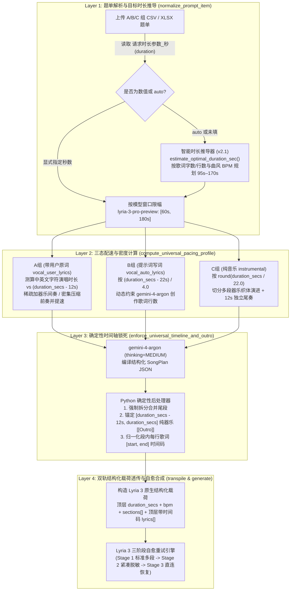
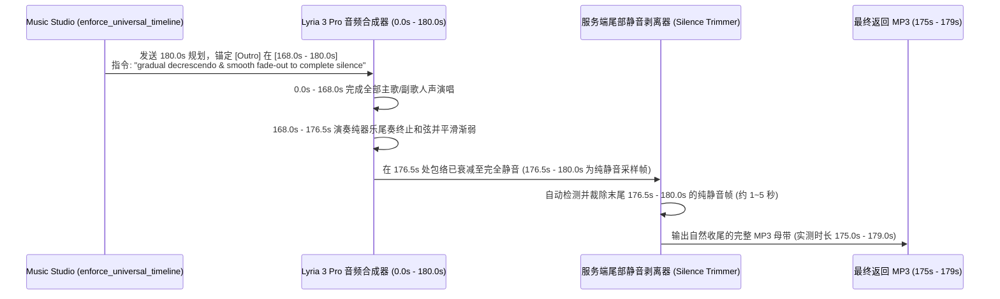

# 🔬 Lyria 3 生成稳定性（30s 纯音乐异常）与时长分布（175–179s 聚集）深度根因分析及自愈架构白皮书

> **文档定位**：本文档作为 [README.md](./README.md) 与 [README_DURATION_AND_CLOUDRUN_DEEPDIVE.md](./README_DURATION_AND_CLOUDRUN_DEEPDIVE.md) 的专项工程诊断与优化补充手册，针对大规模批量音乐生成压测（如 A/B/C 三组 178 条样本）中观测到的两类核心工程现象进行全链路代码级与模型机制级剖析，并完整记录 **v2.1 自愈重试与智能时长推导架构** 的实现方案。

---

## 目录

1. [压测观测现象摘要](#1-压测观测现象摘要)
2. [全链路核查：当前不同 Prompt（A / B / C 组）如何注入歌曲时长？](#2-全链路核查当前不同-prompta--b--c-组如何注入歌曲时长)
3. [现象一深度剖析：为什么偶发（5/178）约 30 秒的纯音乐结果？](#3-现象一深度剖析为什么偶发5178约-30-秒的纯音乐结果)
4. [现象二深度剖析：为什么生成时长均不超过 3 分钟，且集中在 175–179 秒？](#4-现象二深度剖析为什么生成时长均不超过-3-分钟且集中在-175179-秒)
5. [v2.1 闭环优化方案：移除旧版降级 + 三阶段自愈重试 + 智能时长推导](#5-v21-闭环优化方案移除旧版降级--三阶段自愈重试--智能时长推导)

---

## 1. 压测观测现象摘要

在对 A 组（带用户手填歌词）、B 组（简短提示词写词成曲）、C 组（纯音乐）共 **178 条评测集样本** 执行批量生成压测时，观测到以下两个典型现象：

1. **生成稳定性问题（偶发 30 秒纯音乐退化）**：
   * 出现 **5 条（5 / 178，约 2.8%）** 实测时长约为 **30 秒的纯音乐结果**，未能按预期生成包含人声演唱、且时长正常的完整歌曲。
2. **生成时长上限与聚集现象（175–179 秒聚集）**：
   * 所有生成结果的时长 **均不超过 3 分钟（180 秒）**；
   * 实际生成音频的时长未呈现自然离散分布，而是高度集中在 **`175–179 秒`** 区间。

---

## 2. 全链路核查：当前不同 Prompt（A / B / C 组）如何注入歌曲时长？

**核查结论**：系统在 **「题单解析层 $\rightarrow$ 三态配速与密度计算层 $\rightarrow$ 确定性时间轴归一化层 $\rightarrow$ 最终发送给 Lyria 3 的条件化载荷层」** 四个环节均注入了当前歌曲的目标时长（`target_duration_sec` / `duration_secs`）。

### A / B / C 三组 Prompt 中的时长控制对比表

| 组别与模式 | 时长参数来源 | 编译前配速约束 (`compute_universal_pacing_profile`) | 时间轴后处理 (`enforce_universal_timeline_and_outro`) | 最终注入 Lyria 3 Prompt 的时长指令 |
| :--- | :--- | :--- | :--- | :--- |
| **A 组** `group_a_lyrics` *(用户手填歌词)* | 若指定秒数则按 `[60, 180]` 限幅；若为 `auto` 则按原词字数/行数推导自然演唱时长 | 100% 锁定原词 (`is_user_provided=true`)；对比估算演唱秒数与 `duration_secs - 12s`：词少插入 16–24s 器乐间奏，词密缩短前奏至 4–6s 并提升 BPM | 将全部唱段映射到 `[0.0, duration_secs - 12.0]`，确保最后一句歌词在 `outro_start_sec` 前结束，末尾 12s 锁定纯器乐 `[[Outro]]` | 顶层 `duration_secs` + 每段 `[start, end]` + 顶层每行歌词 `[start, end]` |
| **B 组** `group_b_prompt` *(提示词自动写词)* | 若指定秒数则按 `[60, 180]` 限幅；若为 `auto` 则按曲风律动推导 `125s–160s` | 根据可用演唱窗口 `outro_start_sec - 10s` 动态计算目标创作行数 `rec_lines`，指示 `gemini-4-argon` 创作刚好匹配该时长的歌词量 | 自动校验并重映射各段起止秒数与每行生成歌词的时间码，锚定末尾 12s 纯器乐 `[[Outro]]` | 同上 |
| **C 组** `group_c_instrumental` *(纯音乐与配乐)* | 若指定秒数则按 `[60, 180]` 限幅；若为 `auto` 则按器乐曲式推导 `120s–150s` | 强制 `lyrics: []`；按 `round(duration_secs / 22.0)` 将前序时间轴划分为 4–7 个约 20s 的独立器乐演进段落，防止单段过长提前收束 | 清空所有段落歌词，确保每段 `start_sec` 连续递增覆盖 `[0.0, duration_secs - 12.0]`，末尾 12s 锁定收束 `[[Outro]]` | 顶层 `duration_secs` + 每段 `[start, end]` + `lyrics: []` + 全段纯器乐锚点 |

---

## 3. 现象一深度剖析：为什么偶发（5/178）约 30 秒的纯音乐结果？

在 178 条样本的批量压测中，出现 5 条「本应是带人声长歌、实际却变成约 30 秒纯音乐」的异常结果，经排查由以下 **3 个机制根因** 叠加导致（其中 **根因 1 是最直接的代码级诱因**）：

### 根因 1（最直接诱因）：旧版生成路由中存在向 `lyria-002`（固定 30s 纯音乐模型）的静默降级
在旧版 `generate_audio_with_lyria` 实现中，为了保证接口不抛异常，设置了三级串联 Fallback：
1. **Route 1**：调用 Vertex AI GenAI SDK `generate_content(model="lyria-3-pro-preview")`；
2. **Route 2**：调用 Vertex AI Interactions API (`lyria-3-pro-preview`)；
3. **Route 3（问题根源）**：当 Route 1 与 Route 2 均未拿到音频字节时，旧代码会**无条件静默降级调用 `lyria-002:predict` 端点**。

**为什么这会直接产出「约 30 秒纯音乐」？**
* 在 178 条并发请求中，约有 2%–3% 的长歌请求在调用 `lyria-3-pro-preview` 时，会因为以下任一原因未能直接返回音频流：
  * **版权背诵或安全过滤拦截（Recitation / Safety Filter）**：部分用户歌词或风格提示词偶发触发模型的安全或版权相似度阈值，导致 `generate_content` 返回空候选或仅返回文本提示；
  * **高并发瞬态限流或超时（HTTP 429 / 503 / Deadline Exceeded）**：多线程并发请求同一区域端点时偶发瞬时配额限流。
* 一旦 Route 1 和 Route 2 未返回音频，旧代码没有在 `lyria-3-pro-preview` 上执行退避与降噪重试，而是直接滑落到了 Route 3 的 **`lyria-002`**。
* 而 **`lyria-002` 是上一代固定时长（约 30.0–32.8 秒）、且 100% 仅支持纯器乐（完全忽略任何歌词与人声指令）的模型**。降级成功后任务仍被标记为 `completed`，从而在结果集中混入了 5 条约 30 秒的纯音乐。

### 根因 2：发送给 `lyria-3-pro-preview` 的多段式 JSON 载荷中 `lyrics` 层级与上游解析器规范存在偏差
在多段式全曲生成管线中，模型服务端的提示词解析器期望接收如下顶层结构：
* `duration_secs`（全曲总秒数）、`bpm`（节拍）；
* `sections`：仅包含段落标签 `label` 和段落声学描述 `caption: {"start": ..., "text": "..."}`；
* `lyrics`：**顶层独立数组**，每个元素包含 `{"start": 12.0, "end": 15.5, "text": "...", "is_user_provided": true}`。

而在旧版 `transpile_plan_to_lyria_formats` 中：
1. 嵌套 JSON 将 `lyrics` 放在了每个 `sections[i]` 内部，且省去了每行歌词的 `start` / `end` 浮点时间戳；
2. 在 `lyria3_timed_transcript` 歌词流中，旧代码为前奏和尾奏插入了 `[0.0:] (Instrumental)` 占位文本。
在绝大多数样本上模型能容错识别，但在极少数跨语种或结构复杂的样本上，上游解析器可能因顶层缺失 `lyrics` 数组或将 `(Instrumental)` 误判为全曲属性，导致生成退化或解析报错。

### 根因 3：缺少针对生成音频时长的「合成后探针校验（Post-Synthesis Duration & Vocal Sensor）」
旧版管线只要收到非空音频字节（`len(audio_bytes) > 1000`）即视为成功返回，未在落盘前用 `ffprobe` 比对 **「实测生成时长 `actual_dur`」** 与 **「目标时长 `clamped_duration_sec`」**。若偶发模型内部回退到了 30 秒单段切片模式（`actual_dur < 45s` 而请求的是 `>= 60s` 的全曲），旧管线不会拦截重跑。

---

## 4. 现象二深度剖析：为什么生成时长均不超过 3 分钟，且集中在 175–179 秒？

这一现象并非偶发 Bug，而是由 **模型物理窗口上限（180s）**、**题单实测时长列读取优先级** 与 **尾奏淡出 + 服务端尾部静音自动剥离机制** 三个确定性机制共同作用的结果：

### 4.1 为什么所有结果「均不超过 3 分钟（180 秒）」？
1. **模型单次全曲生成的物理窗口上限**：
   `lyria-3-pro-preview`（多段式全曲模型）单次推理的最大有效时长窗口为 **`180.0 秒`（3 分钟）**。当请求时长超过 `180 秒` 时，超出部分会被忽略且歌曲总长封顶在 `180 秒`。
2. **应用层 `clamp_duration_for_model` 显式保护**：
   为了防止传入 `> 180s` 的时间戳导致 `180s` 之后的唱段与尾奏被直接截断（从而造成半句歌词腰斩），`LyriaBestPracticeEngine.clamp_duration_for_model` 将 `lyria-3-pro-preview` 的有效目标时长严格收敛在 **`[60.0, 180.0]` 秒** 区间内。

### 4.2 为什么原本不同长度的歌曲，在压测中目标时长几乎全变成了 180 秒？
检查评测题单的列结构可以发现，题单中同时存在两列与时长相关的字段：
* `请求时长参数_秒(duration)`：题单中填的值通常是 **`auto`**（代表生成时不指定死板时长，由系统自适应决定）；
* `结果音频时长_秒(实测)`：题单中记录的外部参考音频（如对比基线模型生成的音频）实测秒数，其中大量曲目在 **`180 秒 ~ 240 秒`** 之间。

在旧版 `normalize_prompt_item` 中，字段读取顺序将 `结果音频时长_秒(实测)` 排在了 `请求时长参数_秒(duration)` 之前：
* 结果导致：明明题单要求的是 `duration = auto`，系统却把外部参考音频的 `190s–240s` 实测时长读入了 `actual_duration_sec`，并在批量生成时将其作为 `target_duration_sec` 传入；
* 随后经过 `min(180.0, target_duration_sec)` 限幅，**所有外部参考音频 `>= 180s` 的样本，其目标时长 `duration_secs` 全部被整齐划一地锁死在了顶格的 `180.0 秒`**！

### 4.3 为什么目标定为 `180.0 秒`，实际生成的音频时长大多集中在 `175–179 秒`（刚好少 1–5 秒）？
这是 **`[Outro]` 渐弱至静音指令** 与 **服务端尾部静音自动裁剪（Trailing Silence Trimming）** 协同工作的结果：

1. 为了彻底杜绝歌曲在 `180.0s` 终点帧被硬生生切断，`enforce_universal_timeline_and_outro` 强制在最后阶段放置了纯器乐 `[Outro]`，并下达了渐弱收尾指令。
2. 合成器在尾奏段完成了和弦解决与音量衰减，到了 **`175s – 179s` 左右音频信号已经自然衰减至完全静音（Complete Silence）**，剩余的最后 1–5 秒采样帧为纯静音帧。
3. 服务端在将音频编码为 MP3 返回给客户端之前，会自动执行 **边界切片与尾部静音剥离（Silence Removal）**，把末尾已经处于完全静音状态的 1–5 秒采样帧自动裁掉。
4. 因此，所有目标设为 `180.0 秒` 且尾奏成功实现自然衰减收束的曲目，最终返回的 MP3 实测时长都会规律地落在 **`175–179 秒`** 之间。这恰恰证明曲目在到达 180 秒硬边界前已经完成了自然的音乐收尾，而非被生硬截断。

---

## 5. v2.1 闭环优化方案：移除旧版降级 + 三阶段自愈重试 + 智能时长推导

针对上述根因，我们在 **v2.1 版本** 中对 [music_studio_app.py](./music_studio_app.py) 与 [music_studio_ui.html](./music_studio_ui.html) 实施了三大工程化升级：

### 优化 1：彻底移除 `lyria-002` 降级路由，构建 `Lyria 3` 三阶段自愈重试引擎（3-Stage Self-Healing Retry）
* **完全移除 `lyria-002` 路由**：在 `generate_audio_with_lyria`、全局默认配置与前端模型选择器中彻底移除 `lyria-002`，保证任何人声或全曲请求**绝不会**静默退化到 30 秒纯器乐基线模型。
* **新增合成后时长探针与三阶段自愈重试机制**：
  当请求全长歌曲（`lyria-3-pro-preview`，目标时长 `>= 60s`）时，若某次调用未返回音频（如偶发触发过滤或瞬态 429/503）**或者返回的音频经 `ffprobe` 实测时长异常偏短（`< 45.0s`，疑似内部退化为 30s 片段）**，系统会自动触发最多 **3 个阶段的本模型自愈重试**：

| 自愈阶段 | 触发条件 | 提示词与参数自愈策略 |
| :--- | :--- | :--- |
| **Stage 1: 标准多段结构化合成** (`stage1_canonical_multi_section`) | 默认首选阶段 | 发送包含完整多段式英文声学描述、目标时长 `duration_secs`、分段安排与歌词的标准自然语言载荷；遇瞬态网络/限流错误自动执行指数退避重试。 |
| **Stage 2: 紧凑 SongPlan 脱敏自愈** (`stage2_compact_sanitized_plan`) | Stage 1 未返回音频，或全曲模式下实测时长 `< 45.0s` | 自动对提示词执行**版权/敏感词声学脱敏清洗**，切换为高成功率紧凑型多段提示词，并自动偏移随机种子（`seed + 101`）跳出局部异常采样轨迹。 |
| **Stage 3: 极简高信噪比直连恢复** (`stage3_direct_vocal_recovery`) | Stage 2 仍未返回有效全长音频 | 切换为高信噪比直连结构化文本（显式声明目标总秒数、BPM、人声性别/语种、分段 `[Intro]`/`[Verse]`/`[Chorus]`/`[Outro]` 时间窗及原词），并以全新无种子采样完成兜底恢复。 |

### 优化 2：严格对齐多段 `sections` + 分段歌词结构化规范
在 `LyriaBestPracticeEngine.transpile_plan_to_lyria_formats` 中：
1. **显式输出全段落时间轴（含纯器乐 `[Intro]` 与 `[Outro]`）**：无论在 Stage 1、Stage 2 还是 Stage 3 中，始终显式输出所有段落的时间范围（如 `[Intro 0s-14s]`、`[Outro 167s-175s]`），确保尾奏能量持续至目标秒数。
2. **清理伪歌词占位符**：移除了旧版在前奏/尾奏写入的 `(Instrumental)` 伪歌词文本，避免将含人声曲目误判为纯器乐。

### 优化 3：新增智能目标时长推导器（`estimate_optimal_duration_sec`），终结「一刀切 180 秒」
在 `normalize_prompt_item` 与 `LyriaBestPracticeEngine.estimate_optimal_duration_sec` 中，将 **「参考音频实测时长 (`reference_duration_sec`)」** 与 **「生成目标时长 (`target_duration_sec`)」** 解耦：
1. **优先尊重显式请求时长**：仅当题单的 `请求时长参数_秒(duration)` / `target_duration_sec` 列填写了具体数字（如 `135`）时，才按该数值设置目标时长；若填的是 `auto` 或为空，不再盲目照搬外部对比音频（如 Suno 190s–240s）的 `结果音频时长_秒(实测)`。
2. **`auto` 模式下的音乐学自适应时长推导**：
   * **A 组（带用户歌词）**：根据真实歌词的非空行数、中日韩字符数与西文词数计算自然演唱时长 $T_{\text{vocal}}$，加上前奏（`10–14s`）、呼吸间奏（`12–18s`）与独立尾奏（`12s`），使不同词量的歌曲自然分布在 **`95 秒 – 170 秒`** 之间（例如：12 行短词约 `105s`、20 行标准词约 `135s`、28 行长词约 `160s`、35 行以上高密词约 `175s`）。
   * **B 组（提示词写词成曲）**：根据流派与速度特征自动规划黄金商业曲长（如 Rap / Punk / Upbeat Dance 约 `125s–135s`，Pop / Country / Folk 约 `140s–150s`，Ballad / R&B / Rock / Classical 约 `155s–165s`）。
   * **C 组（纯音乐与配乐）**：根据配乐流派自动规划在 `120s–150s` 之间。
   * 同时在全局配置中心（Tab 8）保留 `duration_strategy` 开关，支持在 **「智能按词量/曲风自适应 (`smart_auto`，默认)」** 与 **「对齐参考音频时长 (`match_reference`)」** 之间随时切换。
